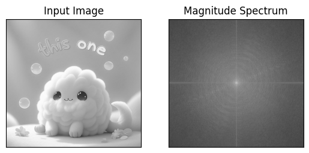

# DIP Problem Set 4 — Fourier Filtering

Fourier transforms and frequency-domain image filtering in NumPy and OpenCV.

**Portfolio:** [Carl Renz Colico](https://github.com/renzkie8) · **Year:** Year 2

## Methodology

Transform an image into the frequency domain, inspect magnitude spectra, apply frequency filters and reconstruct the image.

## Results and limitations

Notebook and input image are preserved. Outputs can be regenerated by running the cells in order.

This upload documents the supplied submission. Experiments, model training, graphical interfaces and external services were not fully rerun during portfolio preparation. See VALIDATION.md for checks actually performed.

## Getting started

Open the notebook with JupyterLab or Jupyter Notebook. Install the imports used by its cells in a dedicated environment, obtain the inputs described in DATA.md, check local file paths, and run cells in order. GPU/cloud and historical library assumptions in the source may need adjustment.

## Contents

See [FILES.md](FILES.md) for the file inventory and [DATA.md](DATA.md) for inputs and exclusions. Original documentation, when supplied, follows below. Nonidentical drafts remain identifiable by their original names or a `variant` suffix.

## Provenance and credits

Original comments, team names and reference credits are retained. This repository represents coursework in Carl Renz Colico’s learning portfolio; collaborative or starter code is not claimed as solely individual work.

Source submissions: `PS4_Colico_CarlRenz.zip`

No new blanket license is applied to third-party assets, datasets, course templates or collaborative work. Existing notices remain applicable.

## Topics

python, opencv, digital-image-processing, fourier-transform, image-filtering

## Saved result example

[View the original recorded figure and its provenance](results/README.md). The figure was extracted from the supplied notebook; it was not regenerated during this audit.

